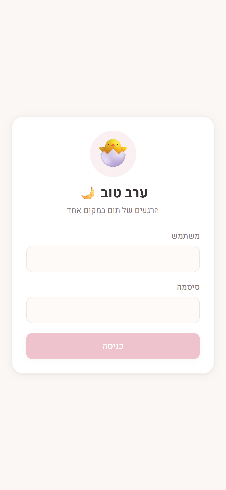
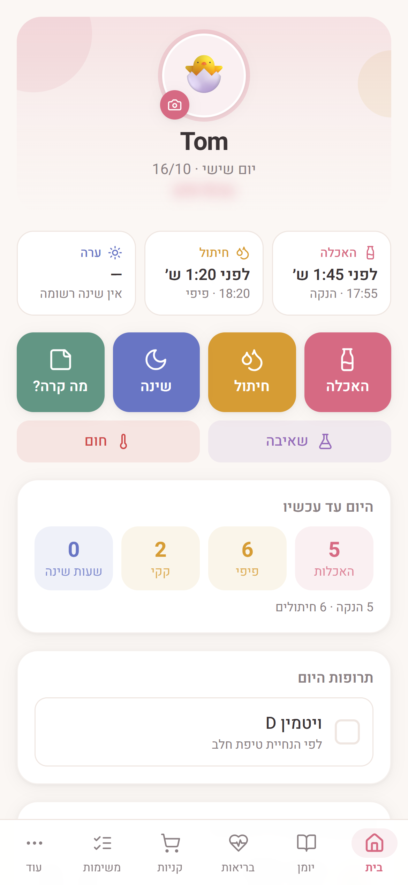

# TommyCare

Tom's daily log (Hebrew, RTL, mobile-first): feedings, diapers, sleep, notes, shopping, doctor appointments, meds, growth, vaccines, fever, pumping, and a PDF report for the doctor. A day runs **06:00 → 06:00**.

## Screenshots

<table>
  <tr>
    <td align="center"><br><sub>Login: greeting by time of day</sub></td>
    <td align="center"><br><sub>Home: last feeding / diaper / sleep, today's totals, today's log</sub></td>
  </tr>
</table>

## Run

```
npm install
npm run dev:local   # port 5173: local test environment, data only in this browser (no Firebase)
npm run dev         # port 5174: against the real Firebase data (login required)
npm run check-gmail # verify Gmail credentials locally before putting them in Netlify
npm run build       # production build → dist/ (always Firebase; the local backend isn't bundled)
```

## Firebase setup (production)

1. Create a Firebase project → **Firestore Database** (production mode) and **Authentication → Email/Password**.
2. Authentication → Settings → **User actions**: turn off "Enable create (sign-up)", so only users you add can log in.
3. Authentication → Users → **Add user** for each family member.
4. Firestore → Rules: paste `firestore.rules`

## Deploy

Netlify builds from `netlify.toml` (`npm run build`, publish `dist`). Automatic builds are off; deploys are triggered by hand
(Netlify → Deploys → Trigger deploy) once a change has been tried on 5173 and 5174.
